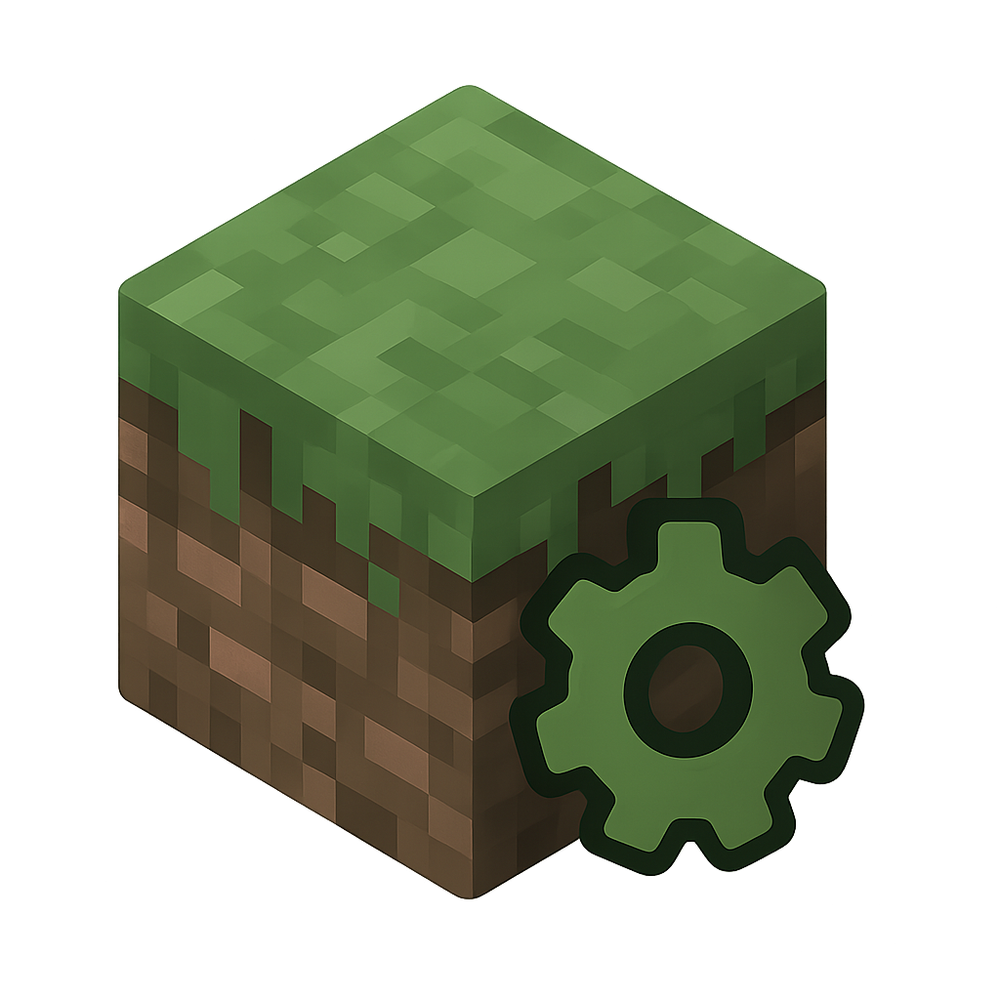

# Minecraft Core

A comprehensive Minecraft Server and Client Management Application built with Electron and Svelte.

## 🚀 Features

### 🖥️ Server Management
- **Complete Server Control** - Start, stop, restart your Minecraft server with one click
- **Real-time Console** - Monitor server logs and execute commands directly
- **Performance Metrics** - Track CPU, RAM, and disk usage in real-time
- **Auto-restart System** - Configurable crash detection and automatic server restarts
- **Server Properties Editor** - Easy-to-use interface for modifying server settings
- **Java Management** - Automatic Java detection and version management
- **Port Configuration** - Flexible port and RAM allocation settings

### 👤 Client Management
- **Minecraft Client Setup** - Automated client installation and configuration
- **Server Connection** - Easy setup for connecting to your managed servers
- **Profile Management** - Multiple client instance support
- **Authentication** - Microsoft account integration for legitimate gameplay

### 📦 Mod Management
- **Universal Mod Support** - Compatible with Forge, Fabric, and Quilt mods
- **Automatic Installation** - One-click mod installation from popular repositories
- **Dependency Resolution** - Automatic handling of mod dependencies
- **Compatibility Checking** - Real-time mod compatibility validation
- **Manual Mod Support** - Drag-and-drop installation for custom mods
- **Server-Client Sync** - Ensure client and server mods are synchronized

### 💾 Backup System
- **Automated Backups** - Schedule regular world and configuration backups
- **Manual Backups** - Create instant backups before major changes
- **Backup Management** - Easy restore and cleanup of old backups
- **Compression** - Efficient storage with automatic compression

### Modpacks (development build)

Server setup can browse Modrinth, inspect uploaded GitHub Release assets, or import a local archive. Choose an exact release and review its Minecraft/loader requirements and destination before installing. Release notifications do not install updates automatically. CurseForge browsing is unavailable in this build.

Server packs and client packs are different:

| Source/format | Server | Matching client |
| --- | --- | --- |
| Modrinth MRPACK v1 | Server-side files and overrides | Client-side files and overrides from the exact paired version |
| GitHub Release | Inspect supported MRPACK/ZIP/RAR server assets | Explicitly pair a same-release MRPACK asset in **Modpack → Matching client pack** |
| Local archive | Inspect supported server content | No remotely downloadable companion pairing |
| MultiMC or CurseForge client export | Not a substitute for a server pack | Not supported by matching client import |

A matching client uses the normal client folder/invite setup, then previews and installs the advertised pack. It installs pack configuration and resources as well as mods, and uses the declared Minecraft/loader versions. Microsoft sign-in remains a normal user action. Existing saves, account data and user settings are preserved; changed pack files can require explicit conflict choices. Tracked running clients or interrupted runtime installation can block mutation until recovery proves it is safe. Process tracking covers launches made by this build; close games launched elsewhere or before upgrading before importing into their directory. A retained-cleanup notice does not mean a successfully verified client is unusable.

While a server is managed as a modpack, ordinary individual mod additions, removals, toggles and version changes are disabled, including edits to user-added mod JARs. Use the Modpack page to change or repair the pack, or review **Detach** to keep the server files and leave pack management before customizing individual mods. Searching, metadata matching, ignored-update preferences and non-mod resource/shader controls remain available.

Archive scripts are not executed automatically. ZIP/RAR support does not promise that every arbitrary archive can be launched without recognized runtime metadata. Download-cache cleanup and retained recovery directories are separate: unresolved recovery data is not deleted merely because it is old.

Native end-to-end verification of this development work is still in progress; see the [verification ledger](docs/testing/2026-10-08-native-modpack-verification.md) for observed passes and outstanding cases.

### 🔧 Advanced Features
- **Multi-Instance Support** - Manage multiple server and client instances
- **System Tray Integration** - Run minimized in system tray
- **Auto-Updates** - Built-in application update system
- **Player Management** - Monitor connected players and their activity
- **Settings Persistence** - All configurations saved automatically
- **Cross-Platform** - Windows support with planned Linux/macOS compatibility

## 🚀 Installation

### Pre-built Releases
1. Download the latest release from the [Releases](https://github.com/zXord/Minecraft-Core/releases) page
2. Run the `Minecraft-Core-Setup-${version}.exe` installer
3. Follow the installation wizard
4. Launch Minecraft Core from your desktop or start menu

## 🏗️ Project Structure

This project follows a structured organization to maintain clarity and ease of development. For a detailed explanation of the directory layout and file organization, see [docs/PROJECT_STRUCTURE.md](docs/PROJECT_STRUCTURE.md).

Key directories:
- `src/` - Frontend Svelte application
- `electron/` - Electron main process code
- `scripts/` - Build and utility scripts
- `config/` - Configuration files
- `shared/` - Code shared between renderer and main processes
- `build-resources/` - Source files for building installers
- `docs/` - Project documentation

## 🛠️ Development Setup

To run the project locally:

1. Install a supported Node.js version (`^22.22.2`, `^24.15.0`, or `>=26`; see `package.json`)
2. Install dependencies with `npm install`
3. Start the development app with `npm run dev`
4. Run tests with `npm test`
5. Build production assets with `npm run build`

## 🐛 Bug Reports

Found a bug? Please open an issue with:
- Operating system and version
- Steps to reproduce
- Expected vs actual behavior
- Screenshots if applicable

## 💡 Feature Requests

Have an idea? We'd love to hear it! Open an issue with:
- Clear description of the feature
- Use case or problem it solves
- Any implementation ideas

## 📊 Stats

